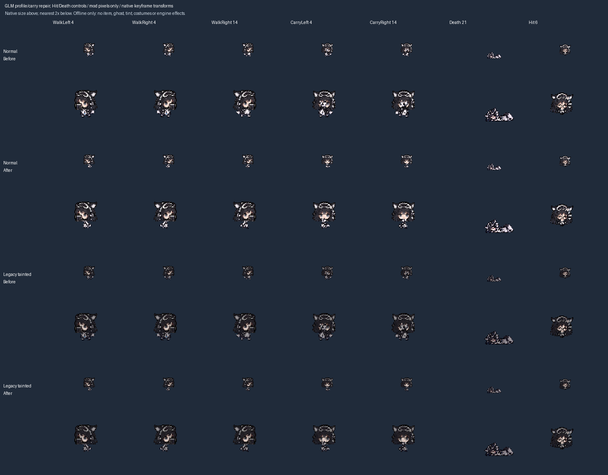

# U6: GLM carry face clearance

Baseline: v2 `72ffb32ef3d5e41c4962560e8f70cfb895299508`. The earlier [GLM profile/fallen repair](GLM_PROFILE_POSES_2026-10-31.md) introduced genuine side bodies, but its common `18/392` fit was too tall for the foreground carry layer. In the private native-transform composition, its raised arms covered the face even though the general body envelope passed. This is an offline finding, not a new owner engine report.

## Repair

Use the existing source at one common `11/392` scale for walking and carrying. Keep the reviewed collar anchors, ground y=26 and three-phase cycle. All ten carry cells now start at y=13, below the reviewed face area. The existing per-family geometry guard, introduced for GPT/Gemini, now also applies to GLM.

Each normal/legacy-tainted GLM sheet changes exactly twenty side/carry cells. Heads, front/back movement, Hit, all Death cells including the horizontal fallen pose, and all other twenty skins remain unchanged. The common scale keeps torso and boot size consistent between the two source rows. Existing source PNGs, generation prompts and reference hashes are unchanged; the registry records this fit revision separately from their original provenance.

`pack_profile_poses.py --body-only` excludes fallen cells from both packing and the pixel-isolation allowance, including when the family has a historical fallen repair. Its default full overlay remains available for complete reconstruction. The same preview flag labels Hit/Death as controls so the new comparison does not imply another fallen redraw. The unchanged tainted generator reproduces the legacy darkened skin; this is not the approved white-haired tainted identity.

## Offline comparison



The supplied carry animation draws body pixels on foreground layer 12 after head layer 4. With the preview's explicit single-key head hold, the central face band (body-cell x=7..24, y=0..12) intersects 47-50 foreground pixels in every baseline walking key and zero in every revised key. The recorded metric covers this chosen band and supplied transforms, not every hairstyle/costume/render effect. The JSON receipt beside the comparison records source hashes without private paths.

No native pixels are rendered or bundled. Interpolation, held-item artwork, costumes, tint, size/flight and engine behavior remain unobserved. The view retains the existing head angles and three-phase stride; it is not a complete animation acceptance pass.

## Verification

With Python and Pillow, from the repository root:

```sh
python tools/pack_profile_poses.py --check --key glm --body-only --before-ref 72ffb32ef3d5e41c4962560e8f70cfb895299508
python tools/verify_hurt_poses.py --unchanged-since 72ffb32ef3d5e41c4962560e8f70cfb895299508
python tools/check_pose_geometry.py
python tools/make_roster_tainted_art.py --check
python tools/preview_profile_poses.py REVIEW_OUTPUT --key glm --body-only --before-ref 72ffb32ef3d5e41c4962560e8f70cfb895299508 --animation-reference PRIVATE_PLAYER_ANM2
python tools/preview_character_poses.py ALL_POSES_OUTPUT --animation-reference PRIVATE_PLAYER_ANM2
bash tools/check.sh
```

Baseline reconstruction and idempotence pass with both full-overlay and body-only packing; fallen pixels match baseline exactly. Legacy tainted output matches the unchanged generator. The complete source/provenance records match baseline, all 22 Hit cells are unchanged, and the selected-family/body-only comparison protects every other pixel. The 22-form/45-key preview reports no clipping warnings, exact left/right mirrors and three GLM body phases.

Four local negative controls reject a same-envelope fallen edit, a head edit, an unrelated GPT body edit and a repeated y=12 foreground pixel in every GLM carry key. The last fault satisfies the older envelope and phase rules but fails only the face-clearance guard. Positive controls pass afterward. These experiments supplement the standard CI gate; they are local checks, not engine evidence.

## Handoff

Installed `8fd6a8c`, gameplay values, saves, settings and game input are untouched. PR #2 remains protected and unmerged; HANDOFF/CHANGELOG consolidation and distinct-tainted runtime production remain dependent on it. All nine tainted design approvals remain valid. Existing ZipZipPipe credits and non-commercial terms continue to cover these mechanically repacked derivatives.

Continue the six remaining normal profile families, special poses with hash-matched private sources, native animation/costume acceptance and the broader U0-U7 work. This is the second substantive unit after the PR #27 hardening reset; schedule the next short review after another one to three units unless a concrete failure takes priority.
