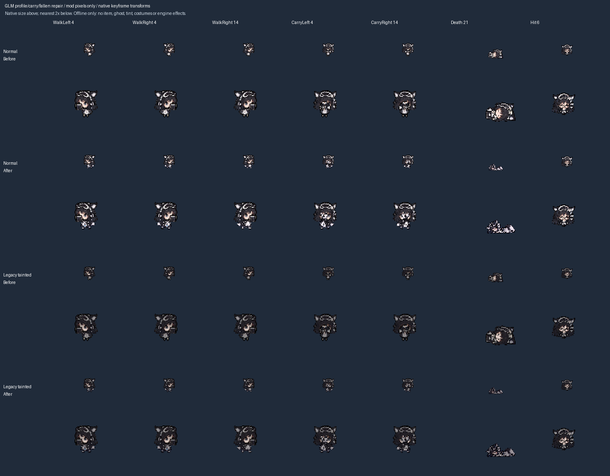

# U6: GLM side, carry and fallen repair

Baseline: v2 `1206a32946d279304f28890ddf4903aec939734a`. This is a normal-identity mechanical art repair and its existing darkened tainted derivative, reviewed offline. The nine distinct tainted designs were approved separately in [v2 PR #25](https://github.com/WaterLily5297/claude-chan-isaac-v2/pull/25); their runtime adaptation remains pending the PR #2 generator/importer dependency.

Later correction: the [carry-clearance follow-up](GLM_CARRY_CLEARANCE_2026-10-31.md) replaces the original body fit described below with `11/392` and protects the face. This document preserves the first repair's historical scale and evidence; its fallen source/output remain unchanged.

## What changes

GLM's side bodies previously came from squeezing a frontal body to 75% width. The new generated source supplies three right-facing clothed body phases and three corresponding raised-arm phases. The engine mirrors the same cells for leftward movement. The fallen source is a complete horizontal reclining pose, replacing the seated-looking source. Heads, front/back movement, Hit, upright Death and all other atlas pixels are unchanged.

Both normal and legacy tainted GLM change exactly 21 storage cells: ten 32px side bodies, ten 32px carry-side bodies and the 64px fallen cell at `(192,128)`. All other twenty registered skins are unchanged. Gameplay Lua, items, menu/portrait/dossier art and the installed build are unchanged.

The [source and prompt registry](profile-pose-repairs.json) holds the actual built-in image-tool requests, generated PNG hashes, input hashes at the baseline and reviewed coordinates. Source PNGs are copied byte-for-byte into `docs/art/pose-sources/`. Packing uses the existing binary-alpha threshold of 128 and nearest-neighbour sampling. One common scale (`18/392`) across all six body parts retains torso size. Reviewed collar x anchors align the body with x=16; feet end at exclusive y=26. Bounding-box centering would wrongly shift the collar because of the tail. Three phases fill the ten engine keys; the body is no longer manufactured by narrowing its front.

The fallen output is 36x17 inside the existing maximum 36x27 envelope, centered at storage bottom 61 (actual native crop bottom 59). Its wider silhouette necessarily has a smaller head than the standing pose at this envelope. Native transition readability, tail motion and the three-phase stride remain engine review cases.

## Review and reproduction



The comparison uses the same player origin, viewport and native keyframe transforms before/after, without independently recentering each pose. The [review receipt](art/glm-profile-review/glm-profile-review.json) records input hashes, never private paths. The native carry head has one two-tick key: the focused preview explicitly holds only that named layer through the cycle, retaining strict frame coverage elsewhere. This preview assumption is not engine evidence.

With Python and Pillow, from the repository root:

```sh
python tools/pack_profile_poses.py --check --before-ref 1206a32946d279304f28890ddf4903aec939734a
python tools/verify_hurt_poses.py --unchanged-since 1206a32946d279304f28890ddf4903aec939734a
python tools/check_pose_geometry.py
python tools/preview_profile_poses.py REVIEW_OUTPUT --before-ref 1206a32946d279304f28890ddf4903aec939734a --animation-reference PRIVATE_PLAYER_ANM2
python tools/preview_character_poses.py ALL_POSES_OUTPUT --animation-reference PRIVATE_PLAYER_ANM2
bash tools/check.sh
```

To deliberately regenerate, run `pack_profile_poses.py` without `--check`, then the unchanged `make_roster_tainted_art.py --skins-only`. This preserves menu/dossier/portrait bytes. The legacy generator may re-encode unrelated skin PNGs with identical pixels; exclude those unrelated encoding-only changes from a focused repair. `pack_selected_sprites.py` also applies the profile overlay after its legacy walk pass and before leftover cleanup, and now validates every original source hash before writing. Original private atlases are not needed for this overlay; a full thirteen-atlas rebuild still requires hash-matched private sources and was not claimed for this unit.

## Validation and evidence boundaries

- Applying the published sources to the baseline normal GLM sheet reproduces current decoded pixels exactly; applying twice is identical. The existing unchanged tainted generator reproduces current tainted pixels.
- All 22 Hit cells remain pixel-identical to baseline, within the measured envelope/ground anchor. The new `verify_hurt_poses.py --unchanged-since` mode checks that invariant without pretending to run its historical thirteen-source, Hit-only reconstruction. The historical mode retains its original isolation assertion and is not the current all-form validator.
- Cross-family comparison permits only the 21 named cells on GLM normal/legacy tainted. The full standard-library geometry gate also checks source hashes, transparent profile gutters, maximum bounds, feet at 26, three distinct phases with exact repetition, and a wider-than-tall fallen silhouette. It does not infer anatomy from those metrics.
- Local negative controls reject source-byte corruption, wrong atlas dimensions, old squeezed/seated art, a below-ground pixel, an inconsistent repeated phase, a changed Hit pixel with unchanged bounds, an unrelated head edit and an unrelated-family edit. Positive controls pass before/after. These experiments are additional offline checks, not CI tests or engine observations.
- The all-form preview renders 22 x 45 keys. Both GLM forms retain exact mirrored side compositions, three distinct side phases and no sampled clipping warnings. Full gate/CI status belongs to the PR check results; no native acceptance is claimed.

## Handoff and remaining work

The remaining eight families (GPT, Gemini, Grok, Qwen, Llama, Mistral, Doubao, Kimi) still need proper profiles, including the geometry inherited by their legacy tainted skins. Use a separately reviewed collar/feet fit per source rather than reusing GLM's anchors. Newly approved distinct tainted identities still need dossier, stage, menu and complete gameplay production after resolving PR #2's overlapping generator/importer work. GLM's approved tainted palette is white/ink/cyan; do not mistake the current darkened skin for that implementation.

Native side/carry movement, Hit/Death, the shared Appear/DeathTeleport fallen cell, size/flight, costume/weapon effects, readability and interpolation remain open. No game was launched, no installed files/settings/saves were changed, and no Workshop publication occurred. PR #2's protected files remain untouched; this focused handoff plus TESTING/ART_STATUS carries the update until HANDOFF/CHANGELOG can be consolidated. Schedule the brief's hardening review after this third substantive unit since the last save-barrier review.
