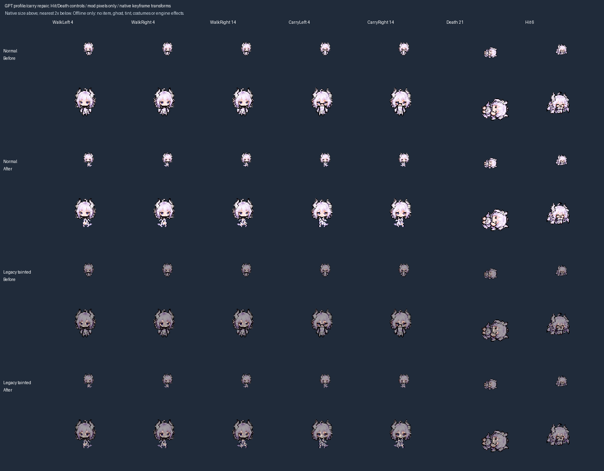
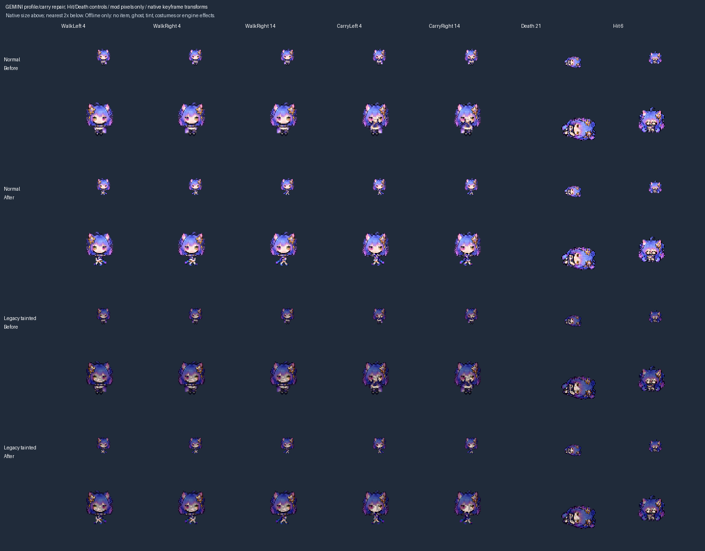

# U6: GPT and Gemini profile/carry bodies

Baseline: v2 `c861dc415fe004487665c409fd7f8236cb7f88ed`. This unit replaces the squeezed-front side bodies of normal GPT and Gemini and their existing darkened tainted derivatives. It is an offline art repair, not the production integration of the separately approved tainted identities.

## Changed assets and packing

Each of the four sheets changes exactly twenty 32px cells: ten walking side bodies and ten carrying side bodies. Existing heads, front/back bodies, Hit, every Death cell and all other atlas pixels remain unchanged. The other eighteen registered sheets are pixel-identical to baseline. No gameplay Lua, item values, menus, dossiers, stage portraits, animation wrappers or installed files change.

The two accepted source PNGs are byte-exact copies of built-in image-tool outputs. [The registry](profile-pose-repairs.json) records the actual revision prompts, source hashes, earlier generation prompts and reference hashes. The intermediate candidates remain private and are explicitly identified as unbundled inputs; no reconstructed prompt is presented as an executed request. Earlier requests produced excessive fine detail, so a second pass simplified the costume shading. Three distinct sampled phases remain, but contact-phase readability still needs native motion review.

Packing uses alpha threshold 128 and nearest-neighbour sampling, without drawing new pixels. Source PNGs retain their original alpha and bytes. GPT uses one `11/350` scale across all six parts; Gemini uses `11/363`. Reviewed collar anchors align with x=16 and feet end at exclusive y=26. Walking parts are approximately eleven pixels tall, with taller raised-arm parts using the same scale. Fitting to the maximum permitted envelope would be incorrect: the carry body is drawn on the foreground `extra` layer, and the initial larger fit covered the face in the offline composition. The selected fit keeps every carry part at y>=13; CI now guards that reviewed clearance for these two families.

Gemini's first carry boot extends across the nominal 512px column boundary. Explicit source rectangles retain the entire boot and surrounding transparent gutter. The packer rejects out-of-image rectangles and cropped source edges. `--key` restricts both writes and allowed pixel changes; a record without `fallen` neither rewrites nor permits changes to its Death cell. The GLM record retains its existing fallen repair and independent baseline.

The unchanged `make_roster_tainted_art.py --skins-only` supplies the legacy tainted recolors. Unrelated encoding-only output changes are excluded after decoded-pixel comparison. This does not bypass the PR #2 dependency for distinct-tainted production.

## Before/after review





The comparisons use a fixed player origin and viewport, private native keyframe transforms and only this mod's pixels. JSON receipts beside the images record hashes, not private paths. The native carry head has a single two-tick key; the preview explicitly holds that named layer throughout the cycle. No item artwork, interpolation, tint, costumes or engine render effects are simulated. Heads retain their existing views; this body repair does not establish complete side-view anatomy.

Layer interpretation follows the supplied animation and the published [costume layer ordering](https://isaacblueprints.com/tutorials/crash_course/costumes/). It remains an offline composition, not an observed engine result.

## Verification and reproduction

With Python and Pillow, from the repository root:

```sh
python tools/pack_profile_poses.py --check --key gpt --key gemini --before-ref c861dc415fe004487665c409fd7f8236cb7f88ed
python tools/verify_hurt_poses.py --unchanged-since c861dc415fe004487665c409fd7f8236cb7f88ed
python tools/check_pose_geometry.py
python tools/make_roster_tainted_art.py --check
python tools/preview_profile_poses.py REVIEW_OUTPUT --key gpt --before-ref c861dc415fe004487665c409fd7f8236cb7f88ed --animation-reference PRIVATE_PLAYER_ANM2
python tools/preview_profile_poses.py REVIEW_OUTPUT --key gemini --before-ref c861dc415fe004487665c409fd7f8236cb7f88ed --animation-reference PRIVATE_PLAYER_ANM2
python tools/preview_character_poses.py ALL_POSES_OUTPUT --animation-reference PRIVATE_PLAYER_ANM2
bash tools/check.sh
```

Applying each source overlay to its baseline normal sheet reproduces current decoded pixels exactly and is idempotent. The unchanged tainted generator reproduces the corresponding recolor pixels. All 22 Hit cells remain identical to baseline. The 22-form/45-key preview reports no sampled clipping warnings; the four changed forms retain exact mirrored side compositions and three distinct body phases.

Additional local fault experiments reject wrong source hashes/dimensions, Gemini's original fixed-grid crop, an out-of-bounds crop, a GPT fallen-cell edit and an unrelated GLM edit. A repeated foreground pixel at y=12 in all ten GPT carry cells satisfies the older envelope/phase rules but fails only the new face-clearance check. Positive controls pass afterward. These local experiments and reconstruction checks supplement CI; they are not new engine evidence or a full rebuild from the thirteen private original atlases.

## Handoff

Six normal families still need profile repairs: Grok, Qwen, Llama, Mistral, Doubao and Kimi, plus their legacy tainted derivatives. GLM was unchanged in this unit; the subsequent [carry-clearance follow-up](GLM_CARRY_CLEARANCE_2026-10-31.md) addresses its foreground face overlap. Existing head views, front/back consistency, special poses, physical walking/carrying, costumes, size/flight, hurt/death and interpolation remain native review cases.

All nine distinct tainted designs are approved; do not request approval again. Their dossier, stage, menu and complete gameplay adaptation still waits for the overlapping PR #2 importer/generator work. PR #2 remains unmerged and unmodified; consolidated HANDOFF/CHANGELOG edits remain deferred, with this document and TESTING/ART_STATUS providing the current record.

No game, input, installation, saves, settings or Workshop action occurred. Preserve installed `8fd6a8c`. This is the first substantive unit after the save-scalar hardening review; the broader U0-U7 goal remains incomplete.
