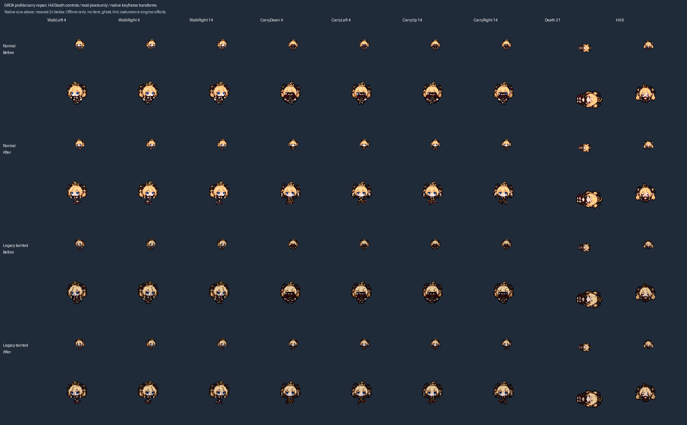
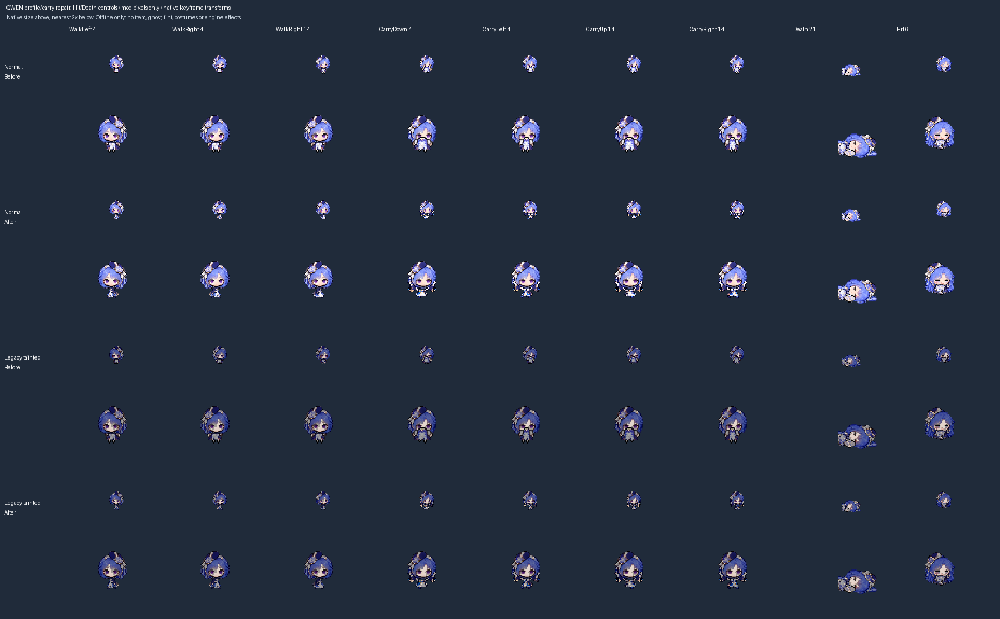

# U6: Grok and Qwen profile and carry bodies

Baseline: v2 `4101dce459baa616a25726d8f27d00860de88828`. In the supplied native carry composition, the old foreground bodies cover the lower face. This repair replaces normal Grok/Qwen side-walking bodies and all four carry directions, including their existing legacy tainted recolors. It is offline only.

## Structure and scope

The private base animation uses the same front carry cells for Down/Up, and the same side carry cells for Left/Right, with the native flips. Its head layer precedes the foreground `extra` body layer. A solid torso in the upper center therefore covers the face. The replacement has raised hands at the sides, an open center, and a small torso below the face. Shrinking a solid torso alone would not preserve the raised-hand pose.

Each of four 512x512 sheets changes exactly thirty 32px cells: ten side-walking, ten front/back-carry and ten side-carry cells. All head cells, ordinary front/back walking, Hit, Death/fallen, the empty carry body0 cells and every other atlas pixel stay unchanged. The other eighteen skins are pixel-identical to baseline. No Lua, gameplay values, menus, dossiers, stage portraits, wrappers or installed files change.

Four built-in image-tool sources and one original geometric guide are preserved under `docs/art/pose-sources/`. [The registry](profile-pose-repairs.json) records exact prompts, source hashes, reference hashes and the unbundled intermediate requests. Initial carry candidates had oversized torsos; Grok also required removal of an extra central hand. The accepted sources retain their original bytes and alpha. The guide contains only original shapes, not extracted game pixels.

Side walking uses the earlier sources' top row only: scales 11/310 for Grok and 11/312 for Qwen, with explicit crops retaining complete shoes. Carry uses separate front/side sources at one scale per family, 26/461 and 26/484 respectively. Mechanical thresholding at alpha 128, nearest-neighbour sampling, reviewed opening-center anchors and exclusive ground y=26 perform the packing; no pixels are drawn by the packer.

The existing geometry gate keeps its previous contracts for GLM/GPT/Gemini. The new carry type instead requires a centered maximum 26x18 envelope, transparent central face strip x=9..22/y=0..12, and visible raised-hand pixels at both sides. Sleeve pixels over side hair are permitted. This strip is a focused foreground guard, not a claim that every head pixel must remain uncovered. All three source phases must remain distinct and repeated cells must match.

## Offline review





The fixed-origin previews show native size and nearest 2x, four carry directions, walking, and unchanged Hit/Death controls. They render only project pixels with private native keyframe transforms. The native carry head has one two-tick key; holding that layer across the cycle is an explicit preview assumption. Native interpolation, item art, tint, costumes and renderer behavior are not simulated.

Baseline-overlay reconstruction, idempotence and equality with the unchanged legacy tainted generator pass. All 22 Hit cells and cross-family isolation pass. All 160 reviewed carry keys (four forms, four directions, ten keys) retain central clearance without sampled viewport clipping. Source phases remain distinct; native gait/readability is still unaccepted.

Seven local fault controls reject a repeated face pixel, removed side hand, protected head/fallen/front-walk edits, an unrelated family edit and an invalid carry-source hash. Positive controls pass after restoration. These reconstruction/fault checks supplement CI; CI runs the existing full gate including the standard-library geometry/source-hash checks. This is not a complete rebuild from the thirteen private original atlases.

## Reproduction

```sh
python tools/pack_profile_poses.py --check --key grok --key qwen --body-only --before-ref 4101dce459baa616a25726d8f27d00860de88828
python tools/verify_hurt_poses.py --unchanged-since 4101dce459baa616a25726d8f27d00860de88828
python tools/check_pose_geometry.py
python tools/make_roster_tainted_art.py --check
python tools/preview_profile_poses.py REVIEW_OUTPUT --key grok --body-only --before-ref 4101dce459baa616a25726d8f27d00860de88828 --animation-reference PRIVATE_PLAYER_ANM2
python tools/preview_profile_poses.py REVIEW_OUTPUT --key qwen --body-only --before-ref 4101dce459baa616a25726d8f27d00860de88828 --animation-reference PRIVATE_PLAYER_ANM2
bash tools/check.sh
```

## Handoff and remaining work

Four newer normal families still need proper profiles: Llama, Mistral, Doubao and Kimi, plus their legacy tainted counterparts. Other families' front/back carry bodies and the original four carry poses still need the same structural review; the earlier GPT/Gemini/GLM side-only fixes do not accept those directions. Existing head views and shared special animations remain open.

All nine distinct tainted designs are approved. These legacy recolors are not their production replacements. That integration still waits for the overlapping PR #2 importer/generator work. PR #2 and its files remain untouched; this record and TESTING/ART_STATUS provide the current handoff while consolidated HANDOFF/CHANGELOG edits are deferred.

Preserve installed `8fd6a8c`. No game, input, installation, saves, settings or Workshop action occurred. Native animation, costumes, weapons, size/flight, saves and playability remain unaccepted. This is the third substantive unit after save-scalar hardening; the carry-structure audit was the targeted review triggered by the visible composition defect. Continue the broader U0-U7 work and the scheduled hardening cadence.
