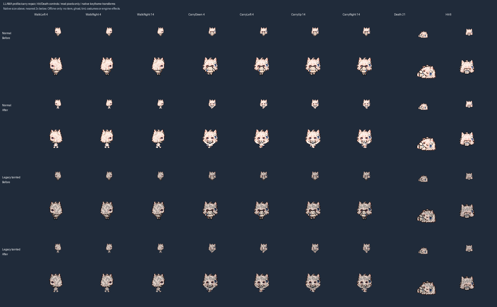

# U6: Llama profile and carry bodies

Baseline: v2 `318525b56a07d79f8eda3a313543875225024f19`. This repair replaces the narrowed-front side body and face-obscuring foreground carry bodies on normal Llama and its existing legacy tainted recolor. It is offline only.

## Artwork and packing

The two [published sources](art/pose-sources/) were made with the built-in image tool from the current credited normal Llama costume. The cream hoodie, blue accents and fluffy slippers remain. The walking source has three genuine right-profile phases. The carry source has front and right-profile rows with raised hands at both sides and a small torso below the separate face. The first carry candidate was too tall and was revised using the existing Grok source only as a proportion reference. It did not replace Llama's costume identity.

[The source registry](profile-pose-repairs.json) records the actual prompts, accepted source bytes/hashes, public input references and the rejected candidate's provenance. The source PNGs are unchanged. Existing packing uses binary alpha coverage, nearest-neighbour scaling and reviewed anchors; no pixels are drawn by the packer. Walking uses one scale of 11/503 and ground y=26. Carry uses one scale of 26/498, centered openings and the same ground. Explicit row-specific crops retain the full hands across the generator's uneven column spacing.

Each 512x512 sheet changes exactly thirty 32px cells: ten side-walking, ten front/back-carry and ten side-carry cells. All heads, ordinary front/back walking, Hit, Death/fallen, empty carry-body crops and every other atlas pixel remain unchanged. All other twenty skins retain their pixels. The unchanged tainted generator supplies the legacy darkened skin; this is not integration of the approved neon tainted Llama identity.

## Offline evidence



The fixed-origin review renders only mod pixels using privately read native keyframe transforms. The single two-tick carry-head key is explicitly held across the cycle in the preview. Native interpolation, held-item art, tint, costumes and renderer behavior are not simulated.

Baseline-overlay reconstruction, idempotence, equality with the unchanged tainted generator, all-22 unchanged-Hit and cross-family isolation checks pass. All eighty supplied carry keys retain the central face opening and both raised hands without sampled clipping. All three source phases remain distinct. Seven deliberate faults are rejected: a repeated pixel over the face, a missing raised hand, edits to protected head/fallen/front-walk cells, an unrelated-family edit and an invalid carry-source hash; positive controls pass after restoration.

The existing standard-library geometry gate checks the published source hashes, phase repetition, centered 26x18 carry envelope, ground, empty central face strip and both hands. Reconstruction/fault controls and private-animation previews supplement that CI gate; they are not a complete reconstruction from the original thirteen private atlases or native acceptance.

```sh
python tools/pack_profile_poses.py --check --key llama --body-only --before-ref 318525b
python tools/verify_hurt_poses.py --unchanged-since 318525b
python tools/check_pose_geometry.py
python tools/make_roster_tainted_art.py --check
python tools/preview_profile_poses.py REVIEW_OUTPUT --key llama --body-only --before-ref 318525b --animation-reference PRIVATE_PLAYER_ANM2
bash tools/check.sh
```

## Handoff

Mistral, Doubao and Kimi still need proper normal/legacy-tainted profiles. Other carry bodies, head views, source-dependent complete poses, Relay Slime and the thumbnail remain open. The historical cut-pose and oversized-hurt-head reports are not closed by this body-only repair. All nine distinct tainted designs remain approved; production integration still depends on overlapping PR #2 work.

This record, TESTING, ART_STATUS, POSE_REVIEW and the art terms provide the focused handoff while PR #2 protects consolidated HANDOFF/CHANGELOG files. PR #2/draft #7, menus, dossiers, stage portraits and gameplay code remain unchanged. Preserve installed `8fd6a8c`: no game, input, installation, saves/settings or Workshop action occurs. Native animation, weapons, size/flight, transformations and playability remain unaccepted. This is the second substantive unit after PR #31 hardening; retain the three-to-five-unit review cadence and full U0-U7 scope.
