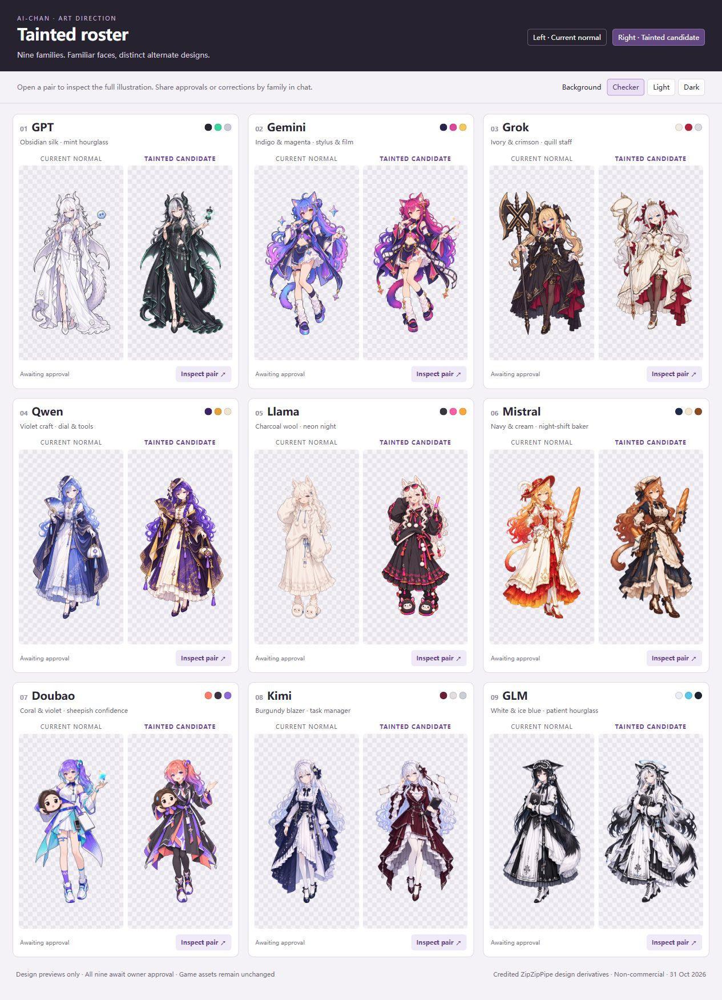

# Nine approved tainted designs

The owner approved all nine full-body alternate designs on 2026-10-31 after viewing the normal/candidate comparison. This unit preserves the exact approved PNG bytes, the comparison that was shown, and their provenance. It does not replace gameplay sheets, dossier or stage images, menu cells, animation wrappers or runtime manifests. Design approval is distinct from packed-sprite and in-game acceptance.

The image's pending labels are historical: the approval reply followed this screen. The [source registry](approved-tainted-designs.json) records each accepted image's SHA-256, dimensions and baseline normal reference. The nine full-resolution images are under `docs/art/tainted-designs/`; they are production inputs, not runtime resources.

| Family | Approved source | Distinct design |
|---|---|---|
| GPT | [GPT](art/tainted-designs/gpt_b.png) | Obsidian gown, silver-black hair, mint seams, wings/tail and hourglass spirit. |
| Gemini | [Gemini](art/tainted-designs/gemini_b.png) | Indigo/magenta outfit, gold stars, stylus and blank film ribbon. |
| Grok | [Grok](art/tainted-designs/grok_b.png) | Platinum twin tails, ivory/crimson gown and quill staff with blank speech ribbon. |
| Qwen | [Qwen](art/tainted-designs/qwen_b.png) | Violet/amber/cream robe, tick-mark dial fan and tuning-fork/wrench charms. |
| Llama | [Llama](art/tainted-designs/llama_b.png) | Charcoal wool, long skirt, neon pink/orange trim, sunglasses, glowstick and llama slippers. |
| Mistral | [Mistral](art/tainted-designs/mistral_b.png) | Copper hair, navy/cream baker outfit, flour-dusted apron and two baguettes. |
| Doubao | [Doubao](art/tainted-designs/doubao_b.png) | Coral-to-violet hair, charcoal jacket, coral/violet panels and sheepish plush. |
| Kimi | [Kimi](art/tainted-designs/kimi_b.png) | Burgundy blazer dress, silver hair, glasses, clipboard and three blank task tags. |
| GLM | [GLM](art/tainted-designs/glm_b.png) | White hair with black tips, white/ink dress, cyan ring and hourglass charm. |

## Provenance and review

GPT, Gemini and Grok use the newer generated candidates. Earlier local candidates were recovered for the other families before unnecessary duplicate generation. Built-in image-tool edits restored Llama's long-skirt silhouette and energetic expression, corrected Doubao's coral hair and accents, adjusted Qwen's framing/dial/tools and added Mistral's flour detail. Kimi and GLM retain their recovered candidates unchanged.

[Prompt records](tainted-portrait-prompts.json) preserve the seven available actual latest generation/edit requests and input hashes. The original Kimi/GLM generation requests and input hashes were not recovered; their fields explicitly say so. A design description must not be presented as an executed prompt. Earlier unselected variants and private generation-session records are not bundled.

All nine source files have real RGBA transparency. Eight are 1024x1536; Mistral is 1023x1538. Source copies were reread and hash matched to the approved candidates without resampling, cropping, recoloring or alpha modification. Read-only alpha inspection and browser rendering on checker, light and dark backgrounds supported the visual review. Some low-alpha edge pixels remain; an intact source illustration is not proof that every scaled native frame will fit correctly. No game or runtime installation was involved.

The comparison loaded all eighteen images. Background switching, enlarged-pair navigation and closing were exercised; no browser console error was observed. The local review interface is not shipped as a mod UI. The non-commercial design conditions and credits in [ART_LICENSE.md](../resources/ART_LICENSE.md) apply to these sources as well as future derivatives.

## Production continuation

1. Recheck v2 [PR #2](https://github.com/WaterLily5297/claude-chan-isaac-v2/pull/2). At this unit's start it is open at `c6f8bf6b746456474454540bb90e5dab59521dbf` and owns the importer, tainted generator, dossier wrappers and validation entry points. The owner's next-steps brief requires waiting before changing overlapping files. Do not redo, rebase or merge that collaborator PR as part of this art unit.
2. Use these exact accepted sources for each family's 384x576 dossier, 144x144 stage/VS portrait and existing 64px tainted menu cell. Keep the accepted Claude/DeepSeek cells and all unrelated menu rows unchanged. Record source and output hashes honestly.
3. Produce identity-matched gameplay frames, including actual side/back views, walk/carry phases, Hit and Death. Keep native cell layout, pivots and the distinct Hit/upright/fallen alpha envelopes in [ART_SPEC.md](ART_SPEC.md). Do not turn the full-body illustration into a gameplay sheet by merely shrinking or darkening it.
4. Once the overlapping work is resolved, update the existing tainted generator to bypass darkening for approved families and validate both retained and independent sources. Do not create a competing generator to evade that dependency. Update the runtime manifests, licence, prompt records and consolidated handoff/changelog together with the production outputs.
5. Run the full gate and the pose/hurt checks, and review at native scale plus enlarged nearest-neighbor scale. Preserve native weapons, size, flight, transformation effects and the fixed-look policy. Native animation, menus, dossiers, hurt/death, save/Continue and gameplay acceptance remain open.

This focused record and ART_STATUS/TESTING provide the current handoff while HANDOFF.md and CHANGELOG.md overlap PR #2. The overall U0-U7 plan remains incomplete. The installed manual-test build and all gameplay values are unchanged; Workshop publication remains unauthorized.
